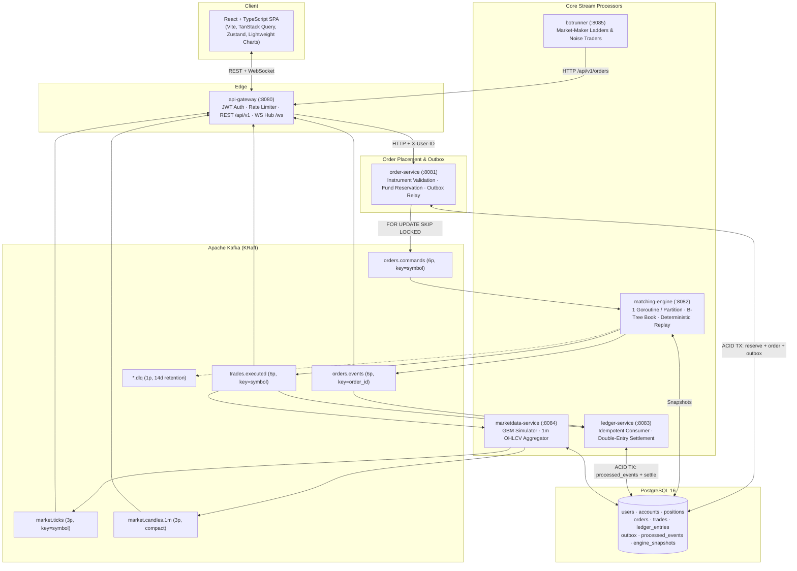

# OrderFlow Architecture & Interview Reference

## 1. End-to-End Topology

---

## 2. Consistency Invariants

1. **No Unbacked Orders on the Book:** `order-service` locks the user's `accounts` (for `BUY`) or `positions` (for `SELL`) row with `SELECT ... FOR UPDATE`, moves `available -> reserved`, inserts the `orders` row (`NEW`), and inserts the `outbox` row inside **one** PostgreSQL transaction.
2. **Per-Symbol Total Ordering:** `orders.commands` is partitioned by `symbol`. Each assigned partition is owned by a single goroutine in `matching-engine`, eliminating lock contention and guaranteeing deterministic price-time priority.
3. **Deterministic Replay & Crash Recovery:** `Engine.Process(cmd)` uses no wall clock or random source. Output event UUIDs (`event_id`, `match_id`) are computed via `UUIDv5(nsEvent, cmd.ID || seq)`. After a crash, restoring from `engine_snapshots` and replaying from `next_offset` reproduces the exact same `event_id`s, which `ledger-service` discards via `processed_events`.
4. **Commutative & Idempotent Double-Entry Settlement:** Each `TradeExecuted` settles its exact slice (`trade.qty`) of the buyer's and seller's reservation, immediately refunding any price improvement `(unit_reserve - trade.price) * trade.qty` to `buyer.available`, and writing 4 balanced `ledger_entries` rows (`DEBIT`/`CREDIT` on `USD` and `symbol`).

---

## 3. Interview Questions & Answers (SDD Section 18)

### Q1. Why partition by `symbol`? What happens if one symbol is hot?
Order matching is a stateful function over an ordered sequence of commands: whether an aggressive order fills against resting order $A$ or $B$ depends on their arrival order. Kafka only guarantees ordering within a single partition, so all commands for a symbol must share a partition.
If one symbol is hot, a single partition can still sustain **~276,000 commands/sec** on one Go goroutine (`~3.6 µs/op`) because the book is entirely in-memory with zero lock contention. If a single symbol ever exceeded single-core/broker limits, we would:
1. Move from JSON envelopes to zero-copy binary/FlatBuffers on the wire,
2. Pin the hot symbol to a dedicated partition (`CustomPartitioner`) on its own broker/core so it doesn't share with other symbols, and
3. Batch Kafka fetches and outbound produces per millisecond.

### Q2. How do you prevent double spending of cash?
Before an order ever reaches Kafka, `order-service` runs a PostgreSQL transaction that executes `SELECT available FROM accounts WHERE user_id = $1 AND currency = 'USD' FOR UPDATE`, verifies `available >= reserve`, and moves the funds from `available` to `reserved` (`CHECK (available >= 0)`). Concurrent requests from the same user serialize on the row lock, so two concurrent orders can never spend the same dollar.

### Q3. What happens if the matching engine crashes after emitting a trade but before committing its Kafka offset?
On restart, the engine loads its latest snapshot from `engine_snapshots`, seeks the consumer to `next_offset`, and replays the uncommitted commands. Because the engine is a pure deterministic function and derives output IDs via `UUIDv5(nsEvent, commandID || index)`, the replayed command produces the **exact same `match_id` and `event_id`**. When `ledger-service` receives the duplicate message, `INSERT INTO processed_events ... ON CONFLICT DO NOTHING` affects 0 rows (and `trades.match_id` has a `UNIQUE` constraint), so the duplicate is safely ignored.

### Q4. Why use the Transactional Outbox instead of writing to Postgres and publishing to Kafka directly in the HTTP handler?
Postgres and Kafka are two separate distributed systems. If the handler commits to Postgres and crashes before publishing to Kafka, the user's funds are locked forever in `reserved` with no order on the book. If the handler publishes to Kafka first and the Postgres commit fails, an unbacked order enters the matching engine. Writing both the `orders` row and the `outbox` row in the same Postgres transaction guarantees atomicity.

### Q5. Why not use Kafka transactions for everything?
Kafka's `sendOffsetsToTransaction` + transactional producer only provides atomic *read-process-write within Kafka* (Kafka-to-Kafka pipelines). It cannot include an external database like PostgreSQL in its transaction boundary without a distributed XA coordinator. Pairing the Transactional Outbox with `processed_events` in PostgreSQL achieves end-to-end exactly-once *effects* across both systems using standard local transactions.

### Q6. How would you scale this to 100x?
1. **Matching Tier:** Shard symbols across 64–256 partitions and run multiple `matching-engine` pods in the consumer group; pin top-volume symbols (`NVDA`, `AAPL`) to dedicated partitions.
2. **Database Tier:** Shard `orders`, `accounts`, `positions`, and `ledger_entries` by `user_id` (or use Citus/CockroachDB), and batch-settle trades in `ledger-service` every 5–10 ms (`COPY` / multi-row `UNNEST` updates sorted by `user_id`).
3. **Gateway Tier:** Scale stateless `api-gateway` pods horizontally behind a load balancer, feeding them from a dedicated market-data fan-out bus with 50 ms L2 book conflation.
